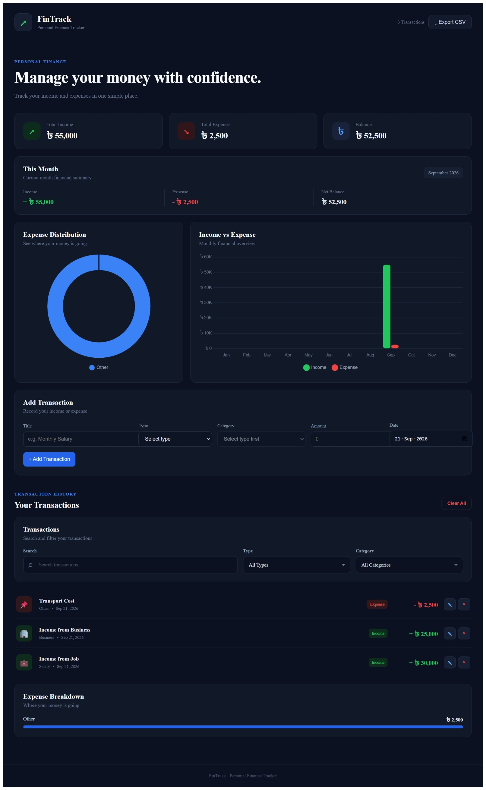

# 💰 FinTrack

A fast, private **Personal Income & Expense Tracker** built with **Vue 3 + Vite**.
Works offline, installs as an app (PWA), and keeps all data in the user's own browser.

## ✨ Features

**Tracking**
- Add / edit / delete income and expense transactions (decimal amounts supported)
- Inline form validation with clear error messages
- Undo for deleted transactions and for "Clear All"
- Search, filter by type & category, sort (newest, oldest, highest, lowest)
- "Show more" pagination, so big histories stay fast

**Insights**
- Total income, expense and balance
- **Monthly summary with a month picker** (follows the current month automatically)
- Expense breakdown by category
- Expense distribution chart + Income vs Expense chart **with a year picker**

**Data safety**
- Saved in `localStorage`, with safe handling of full/blocked/corrupted storage
  (a visible warning is shown and corrupted data is kept as a raw copy)
- **Live sync between browser tabs** - change something in one tab and the others update instantly
- Export CSV (Excel-safe, Bangla-safe, formula-injection-safe)
- **JSON backup & restore**, and CSV import (duplicates are skipped automatically)

**Production quality**
- Installable PWA with offline support (service worker)
- Security headers + strict Content-Security-Policy (Vercel / Netlify / Cloudflare / nginx)
- No third-party requests at runtime (no external fonts, no analytics)
- Accessible: labelled form fields, keyboard focus, screen-reader announcements, reduced-motion support
- Chart.js is lazy-loaded to keep the first paint fast
- Unit tests for all core logic (`npm test`)

## 🚀 Getting Started

```bash
npm install
npm run dev        # development server
npm test           # unit tests (no extra dependencies)
npm run build      # production build -> ./dist
npm run preview    # serve the production build locally
```

Requires Node.js `^22.18.0` or `>=24.12.0`.

## ⚙️ Configuration

Copy `.env.example` to `.env` (or set the variables in your hosting dashboard):

| Variable | Purpose | Default |
| --- | --- | --- |
| `VITE_SITE_URL` | Public site URL, used for canonical / Open Graph / Twitter tags | _(tags omitted)_ |
| `VITE_CURRENCY_SYMBOL` | Currency symbol shown in the UI | `৳` |
| `VITE_LOCALE` | Number/date format locale | `en-BD` |

## 🌐 Deployment

`npm run build` creates a static site in `dist/`. Any static host works.

- **Vercel** - import the repo. Build command `npm run build`, output `dist`. `vercel.json` already sets the security and cache headers.
- **Netlify / Cloudflare Pages** - build command `npm run build`, publish directory `dist`. `public/_headers` is copied into `dist` automatically.
- **VPS (nginx)** - copy `dist/` to the server and use `docs/nginx.conf` as a starting point.
- Set `VITE_SITE_URL` to your final domain before building so social previews work.
- Deploying under a sub-path (e.g. `/fintrack/`)? Set `base: '/fintrack/'` in `vite.config.js`.

> **Important - HTTPS:** service workers, installability and secure headers need HTTPS. All the hosts above provide it by default.

## 💾 Data Storage

Transactions are stored in the browser under the `localStorage` key `fintrack_transactions`.
Data never leaves the device. Because of that, **clearing browser data deletes it** - use
**Backup** (JSON) regularly. This build is intentionally single-device; if you later want
accounts and cross-device sync, add an API (e.g. Laravel or Supabase) behind the same
`useTransactions` composable.

Transaction shape:

```json
{
  "id": "3f2b0c0e-...",
  "title": "Monthly Salary",
  "category": "Salary",
  "amount": 40000,
  "type": "income",
  "date": "2026-10-01"
}
```

Older data saved by previous versions (numeric ids, bare arrays) is loaded and cleaned automatically.

## 📂 Project Structure

```
src/
├── main.js                  # app bootstrap, error handler, service worker
├── config.js                # currency, locale, storage key, page size
├── constants/categories.js
├── composables/
│   ├── useTransactions.js   # state, CRUD, import, totals, cross-tab sync
│   ├── useCurrentMonth.js   # rolls over to the new month automatically
│   └── useToast.js
├── utils/                   # pure, unit-tested helpers
│   ├── money.js  date.js  validation.js  csv.js  backup.js  storage.js
│   └── format.js  download.js  id.js
├── components/
└── App.vue
public/                      # favicon, PWA icons, manifest, sw.js, _headers
tests/utils.test.js
docs/nginx.conf
vercel.json
```

## ✅ Pre-launch checklist

- [ ] `npm test` passes and `npm run build` succeeds
- [ ] `VITE_SITE_URL` set to the real domain
- [ ] Site served over HTTPS
- [ ] Open the deployed site, add a transaction, reload, then go offline and reload again
- [ ] Check the headers at <https://securityheaders.com>

## 📸 Preview



## 👨‍💻 Author

**Sheikh Farid**

Software Developer | Laravel | PHP | Vue.js | JavaScript

---

⭐ If you find this project useful, feel free to give the repository a star.